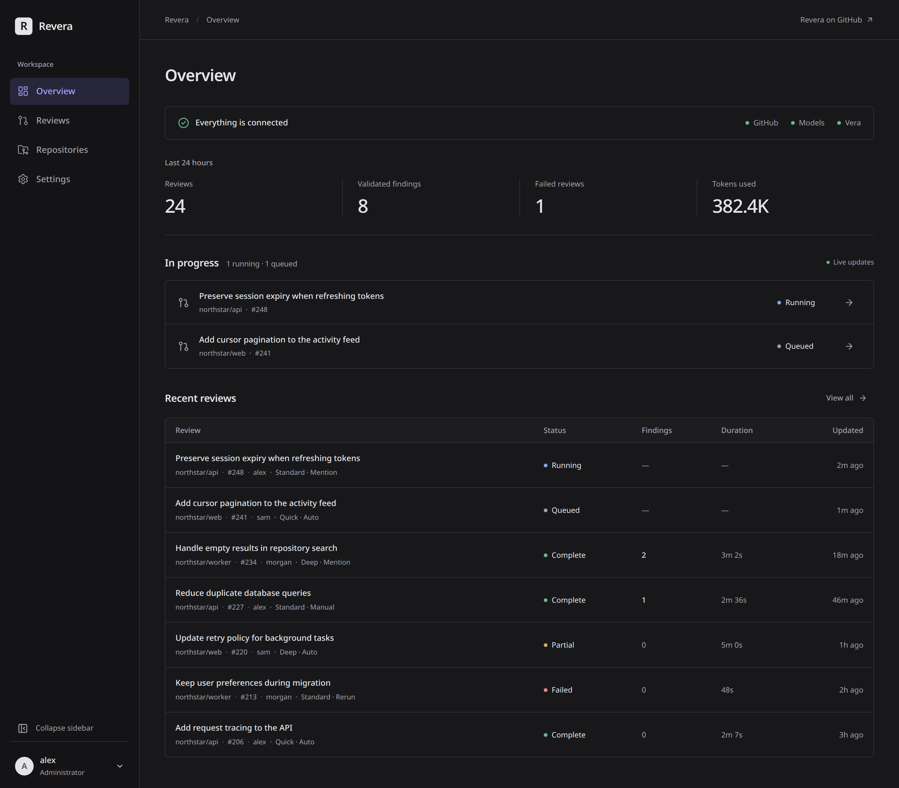

# Revera

Revera reviews GitHub pull requests with the AI models you choose. Before a
finding is posted, a second model checks it again from scratch, so what reaches
your pull request has been confirmed against the code.

[](https://github.com/VeraTools/revera/actions/workflows/ci.yml)
[](LICENSE)



## Why Revera

An investigator reads the change and proposes defects. A validator starts a
new conversation for each finding and must establish it from the code before
it can post. In our evaluation, the default setup posted no false positives
across 13 small test repositories, using the same model for both roles. That
is a small sample, not a guarantee. [Results and caveats](docs/evaluation.md).

Hosted AI reviewers usually pick the model for you and charge per seat. With
Revera you use your own models and keys. It supports OpenAI-compatible endpoints,
OpenAI Responses, Anthropic and Google Gemini. You choose the provider and
model for each role, control the review budget and pay the provider directly.
Code goes only to the providers you configure;
external web search is a separate opt-in.

Ordered fallback models can keep a review running when a provider is
unavailable. The report records which models served the review. A run says
`complete`, `partial` or `failed`: a budget stop or provider failure is not
presented as a clean review.

Findings are tracked across pushes, resolved when fixed and reopened if they
return, without duplicate comments for still-open defects. Built-in text search
works without an index; optional [Vera](https://github.com/VeraTools/Vera)
adds semantic search and reference lookup across the repository.

The self-hosted GitHub App supports on-demand `@mention` reviews with budget-scaled
Quick and Deep modes, approved accounts across organizations, and private reviews
of public PRs without an installation. Revera is open source under MIT. Run the
App, Action or CLI on infrastructure you control.

## Good fit / not a fit

Revera is for teams that want defect reports with a trigger, impact and code
evidence, rather than style nits. It fits projects that already have model
API access and want to choose where reviews run.

GitHub is the only publication target. There is no hosted Revera service.
You run it and pay your model providers. Validation can reject false claims,
but it can still miss bugs or accept a wrong finding; keep human review.

## Choose how to run it

| Run it as | Choose this when | Guide |
|---|---|---|
| Self-hosted GitHub App | You want a dashboard, mentions, multiple organizations or private reviews of public PRs, without per-repository workflows | [GitHub App](docs/server.md) |
| GitHub Action | You want reviews in one repository without running a server | [Action](docs/action.md) |
| Local CLI | You want to review a committed branch before opening a PR | [CLI](docs/cli.md) |

### GitHub App

1. Start the container on your server with a persistent data directory:

   ```sh
   mkdir -p data
   podman unshare chown -R 10001:10001 data
   podman run -d --name revera --restart unless-stopped \
     -p 127.0.0.1:8080:8080 -v "$PWD/data:/data:Z" \
     -e REVERA_PUBLIC_URL=https://review.example.com ghcr.io/veratools/revera:0
   ```

   This uses rootless Podman (without `sudo`). For Docker or rootful Podman,
   use `sudo chown -R 10001:10001 data` instead.

2. Put it behind HTTPS. Open the setup link from `podman logs revera`, create
   and install your GitHub App, then connect your models in the dashboard.
3. Comment `@<app-slug> review` on a PR. The default trigger is **mention**;
   select **auto** to review new and updated PRs automatically.

Docker works too. [The App guide](docs/server.md#quickstart) includes proxy
examples and setup instructions. No YAML file is needed for dashboard setup.

Use **Repositories → Add repositories or organization** to connect another
owner. GitHub installation and Revera approval are separate; an App must be
public-installable to connect other accounts. [Connected accounts](docs/server.md#connected-accounts-and-organizations).

For an open public PR elsewhere, use **Reviews → Review PR URL**. Results stay
in your dashboard: no GitHub comment or check is posted. Optional tracking of
your own public PRs starts off and reviews only PRs you select.
[External reviews, limits and privacy](docs/server.md#external-public-pr-reviews).

### GitHub Action

1. Add `revera.yaml` to your repository's default branch, replacing the
   endpoint and model ID with your provider's values:

   ```yaml
   models:
     investigator:
       protocol: openai-chat
       base_url: https://api.example.com/v1
       api_key_env: REVIEW_API_KEY
       model: your-model-id
   ```

2. Add `REVIEW_API_KEY` under **Settings → Secrets and variables → Actions**.
   Save this as `.github/workflows/revera.yml`:

   ```yaml
   name: revera
   on: pull_request
   permissions:
     contents: read
     pull-requests: write
   jobs:
     review:
       runs-on: ubuntu-latest
       steps:
         - uses: actions/checkout@3d3c42e5aac5ba805825da76410c181273ba90b1 # v7.0.1
           with:
             persist-credentials: false
             fetch-depth: 0
             ref: ${{ github.event.pull_request.head.sha }}
         - uses: VeraTools/revera@v0
           env:
             REVIEW_API_KEY: ${{ secrets.REVIEW_API_KEY }}
   ```

3. Merge the configuration and workflow, then open a PR from a branch in
   that repository. Reviews read configuration from the PR's base commit.

One route is enough: validation reuses it in a fresh conversation. Vera is
off by default. [The Action guide](docs/action.md) covers inputs, forks,
version pinning and keeping the index warm.

### Local CLI

1. Install a binary from [releases](https://github.com/VeraTools/revera/releases),
   or run `cargo install --git https://github.com/VeraTools/revera`.
2. Create `revera.yaml` as above and set `REVIEW_API_KEY` in your shell.
3. Commit your changes, then run:

   ```sh
   revera doctor --config revera.yaml
   revera review --repo . --base origin/main --config revera.yaml --publish dry-run
   ```

This calls your models but posts nothing. [The CLI guide](docs/cli.md) covers
installation, profiles, reports and local state.

## Using it on a pull request

With the GitHub App, mention it by its slug (the app name GitHub shows, such as
`@revera-acme`) in a PR conversation comment:

```text
@<app-slug> review          # use the repository's review mode
@<app-slug> quick           # smaller review budget
@<app-slug> deep            # larger review budget
@<app-slug> review standard # use the configured review without a profile
@<app-slug> help
```

Commands are available to repository owners, members and collaborators.
Both quick and deep keep validation on. The Action uses workflow triggers,
not mentions; set the Action's `profile` input to `quick` or `deep` for the
same modes. [Trigger and mode details](docs/server.md#triggers-review-modes-and-mentions).

A posted finding names the defect, how to trigger it, its impact and the
evidence. This shortened example came from a release test that flipped an
ownership check:

> **[high] owns() returns true for comments with missing author, allowing
> finding suppression via forged revera-id markers**
>
> Changing the `(None, _) => true` arm makes `posted_revera_ids` treat any
> inline review comment whose author is missing as Revera's own. […] GitHub
> returns `user: null` for comments by deleted users.
>
> Trigger: a PR has an inline comment from a deleted account whose body
> contains a revera-id marker matching a finding Revera is about to post.
> Impact: the finding is silently suppressed.
> Evidence: src/github/publish.rs:87, src/github/publish.rs:184,
> src/github/api.rs:102, tests/outcome_tests.rs:530

Accepted findings appear inline when they can be anchored to the diff;
others appear in the managed summary. The summary reports completion and
tracks open, resolved and reopened findings across pushes.

The dashboard shows accepted findings with evidence and links to the reviewed
code. Copy or download instructions for your coding agent; complete reviews
with findings also include a **Fix with your coding agent** section on GitHub.
Small, exact replacements can appear as suggested changes, not tested patches.
[Finding details and handoff](docs/how-it-works.md#findings).

The GitHub App can also generate [fix previews](docs/server.md#fixes-opt-in)
in a sandbox. Execution is off by default; an administrator can consent to
one request or enable it persistently. Publishing code to GitHub always needs
an administrator's approval in the dashboard.

## How it works

1. Rust computes the base-to-head diff over the exact committed head.
2. Optional Vera retrieval refreshes the repository index.
3. The investigator explores with read-only tools and submits candidates.
4. A fresh-context validator re-derives each candidate independently.
5. Rust anchors and deduplicates accepted findings, then reconciles prior state.
6. It posts comments or prints a dry-run plan. Review models cannot run shell commands or write files.

## Documentation

- [GitHub App](docs/server.md) · [GitHub Action](docs/action.md) · [Local CLI](docs/cli.md)
- [Configuration](docs/configuration.md), including [fallback models](docs/configuration.md#fallback-models), [profiles](docs/configuration.md#profiles) and [web search](docs/configuration.md#web_search)
- [How it works](docs/how-it-works.md), including review strategies and trust boundaries
- [Evaluation](docs/evaluation.md): measurements, limitations and reproduction
- [Contributing](CONTRIBUTING.md) · [Security](SECURITY.md) · [Changelog](CHANGELOG.md)
- [Upgrading from 0.7.0](docs/server.md#from-070-to-080): existing review-only installations need no change

## License

[MIT](LICENSE).
