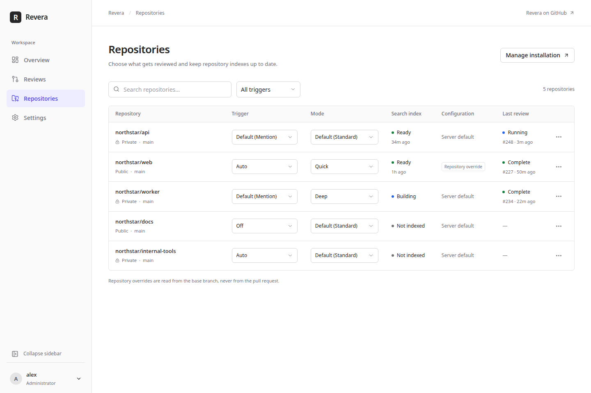
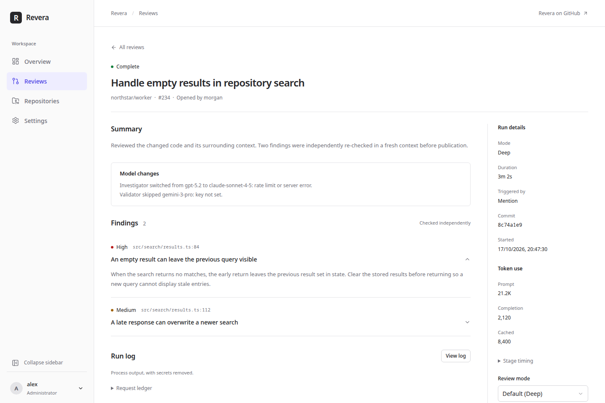

# Self-hosted GitHub App

Run Revera on your server, install your GitHub App and manage reviews in a
browser. Choose all repositories to include new ones without adding workflows
or repository secrets. You can also privately review open public PRs without
installing the App on their repositories. For reviews hosted by GitHub instead,
use the [Action](action.md).

## Quickstart

1. Start the container on a server with a public HTTPS address and persistent
   storage. The data directory must be writable by container user 10001:

   ```sh
   mkdir -p data
   podman unshare chown -R 10001:10001 data
   podman run -d --name revera --restart unless-stopped \
     -p 127.0.0.1:8080:8080 -v "$PWD/data:/data:Z" \
     -e REVERA_PUBLIC_URL=https://review.example.com ghcr.io/veratools/revera:0
   ```

   This uses rootless Podman (without `sudo`). For Docker or rootful Podman,
   use `sudo chown -R 10001:10001 data` instead. Replace the example URL with
   yours. For Docker, use `docker` in place of `podman`; omit `:Z` on hosts
   without SELinux. No YAML file is needed yet.
2. Put an HTTPS reverse proxy in front of `127.0.0.1:8080`. Keep that port
   private. [Caddy and nginx examples](#https-reverse-proxy) are below. GitHub
   must be able to reach `/webhook` without an interactive login.
3. Run `podman logs revera` and open the setup link. Treat it as a secret.
   Keep using that browser until setup finishes.
4. Create and install the GitHub App. Change its name if taken, and enter your
   organization if needed. Under **Who can install this app?**, keep **Only
   this account** (private) or choose **Any account or organization** if you
   want to connect other owners. Other owners still need Revera approval.
   Leave **Allow Revera to publish approved fixes** unchecked for review-only
   use: Contents stays read-only. Checking it requests Contents write; it
   does not authorize execution or a code write.
   Click **Create GitHub App**, confirm on GitHub,
   then sign in with GitHub in the same browser. That browser becomes the
   first administrator. Follow the installation redirect and choose **All
   repositories** or selected repositories. You need permission to create
   and install an app on that account.
5. Return to the dashboard and connect a model endpoint, model ID and key.
   Test the connection and finish setup. One model route is enough: validation
   reuses it in a fresh conversation. Retrieval is optional; if enabled,
   configure and test its embedding endpoint. You can also configure a reranker.

Comment `@<app-slug> review` on a PR to start a review. The default trigger
is **mention**. Choose **auto** in the dashboard if you want reviews on PR
events instead. Existing open PRs are not reviewed in bulk after installation.

The server saves app credentials in `/data/app.json`; app creation and its
callback then close. The `/setup` page remains available for configuration
and recovery. Until model configuration is saved, jobs are skipped without
creating PR checks. The dashboard writes `/data/revera.yaml` when you save models.

## Review guidance

Set a per-repository guidance level and operator notes in **Repositories →
Review guidance**, and preview the files and skills on the default branch.
An unset level inherits the review configuration; notes supplement its
`review.notes` (8000 characters total). Repository preferences apply even when
the repository has its own base-commit `revera.yaml`. The preview uses the
server configuration for its global defaults; a repository's YAML can differ.
Reviews read guidance and skills from the PR's immutable base commit, not its
head. External/private reviews ignore these preferences and notes.

The admin-only read APIs are `GET /api/repos/{owner}/{repo}/guidance` and
`GET /api/repos/{owner}/{repo}/guidance/file?path=AGENTS.md`. The file endpoint
only serves preview candidates. A truncated GitHub tree is marked in the
preview. Guidance stays `off` by default; see [configuration](configuration.md#review).

## Connected accounts and organizations

GitHub decides who may install an App on an account or organization. Revera
separately decides which installed owners this deployment may review. Making
the App public lets other accounts install it; it does **not** make the
dashboard public, add administrators or approve those owners in Revera.
The App's owning account is allowed initially, along with configured allowed
owners. An administrator can revoke that approval too.

To connect another account or organization:

1. Open **Repositories → Add repositories or organization**. GitHub opens its
   installation page. A private App can only be installed on its owning account;
   [make an existing App public](#change-an-existing-github-app) first if needed.
2. Choose the account or organization, then **All repositories** or **Only select
   repositories**, and click **Install**. You need GitHub permission to install
   the App there; an organization's policy may require an owner to approve it.
3. Return to **Repositories → Connected accounts**. New Apps redirect here and
   refresh the inventory. If the return flow is missing or the list is old,
   open this page yourself and click **Refresh**.
4. Click **Approve** beside an owner awaiting Revera approval. This saves the
   choice and refreshes its repositories without a restart. Only Revera
   administrators can approve or revoke owners; being a GitHub organization
   owner does not grant dashboard access.

| Status | What to do |
|---|---|
| **Allowed** | The installed owner is approved in Revera. The row shows its repository count and selection. |
| **Awaiting Revera approval** | Click **Approve** if this deployment should review the owner's repositories. Their names are not listed before approval. |
| **Permission update required** | Open **Manage on GitHub** and have the installation owner accept the requested permissions. Revera approval is separate. |
| **Suspended** | Use **Manage on GitHub → Unsuspend** where available, or ask the App owner. Revera cannot use a suspended installation. |
| **Not installed** | The owner is allowed but has no installation. Use **Install on GitHub**. |
| **Access unavailable** | Read the row's error, check GitHub access and try **Refresh**. An API error is not necessarily an uninstall. |

**Manage on GitHub** opens that installation. Under **Repository access**, change
**All repositories** or **Only select repositories**, choose repositories and
click **Save**. You can also suspend or uninstall there. Installation changes
refresh Revera through webhooks and periodic reconciliation; **Refresh** checks
immediately. Removed repositories leave the inventory and their work is cancelled.

**Revoke** withdraws Revera approval, removes that owner's repositories and
cancels queued and running work. It does not uninstall the App on GitHub.
Approvals follow GitHub account IDs across renames; login matching ignores case.

### Change an existing GitHub App

Setup choices only affect a new registration. Re-running a manifest does not
change an App that already exists. The expandable help in **Connected accounts**
links directly to its GitHub settings. To navigate there yourself:

1. On GitHub, click your profile picture → **Settings**. For an organization-owned
   App, use profile picture → **Your organizations** → **Settings** beside its owner.
2. Open **Developer settings → GitHub Apps → Edit** beside the App.
3. To allow installation on other accounts, open **Advanced → Danger zone →
   Make public** and follow GitHub's confirmation. You need permission to manage
   the registration. Public Apps installed on other accounts cannot be made
   private until those installations are removed.
4. To change permissions, open **Permissions & events → Repository permissions**,
   change the relevant dropdown, then click **Save changes**. For example,
   optional code-write access uses **Contents → Read and write** instead of
   **Read-only**. Keep Contents read-only if you only need reviews. Every
   installation owner must separately accept added permissions; changing the
   registration alone does not grant them.
5. For the return flow, on **General**, under **Post installation**, set **Setup
   URL** to `https://<your-host>/repositories`, select **Redirect on update** and
   save. Keep the authorization callback at `https://<your-host>/auth/callback`.

To accept a permission request, use **Manage on GitHub** or GitHub's notification
email and review the requested permissions. You can also reach a personal
installation through profile picture → **Settings → Applications → Installed
GitHub Apps**, or an organization installation through **Your organizations →
Settings → Third-party Access → GitHub Apps**. Open the app's **Configure** or
pending **Review request**, then **Accept new permissions**. Return to Revera
and click **Refresh**. [GitHub's registration guide](https://docs.github.com/en/apps/maintaining-github-apps/modifying-a-github-app-registration)
describes the visibility and permission controls.

## Triggers, review modes and mentions

Set defaults in **Settings → Review** and overrides in **Repositories**.
Trigger and mode are independent; a repository can inherit either default.

| Trigger | Behavior |
|---|---|
| `mention` (default) | Review on command or manual request; keep the index warm on default-branch pushes |
| `auto` | Also review opened, reopened, updated and ready-for-review PRs, and recover missed head changes |
| `off` | Stop new reviews and indexing, including mentions and manual requests |

Changing a trigger or mode does not cancel work already queued or running. Removal
and cancellation still work when a repository is off.

| Mode | Behavior |
|---|---|
| `standard` (default) | Configured review without a profile |
| `quick` | Apply the `quick` profile for a smaller budget |
| `deep` | Apply the `deep` profile for a larger budget |

Built-in quick and deep modes scale from your configured budget, keeping
the configured strategy and validation.
Custom profiles with those names replace the built-ins. See
[profile defaults](configuration.md#profiles).

Use the app's slug in a new PR conversation comment:

```text
@<app-slug> review
@<app-slug> quick
@<app-slug> deep
@<app-slug> review quick
@<app-slug> review standard
@<app-slug> review deep
@<app-slug> help
```

`review` uses the repository's effective mode. The slug is case-insensitive.
Only OWNER, MEMBER and COLLABORATOR commenters can run commands. Bots,
comment edits, ordinary issues, quoted lines and code are ignored. Unknown
commands receive help. A valid command gets an eyes reaction and forces a
review of the current head, including drafts and otherwise skipped authors.
A closed PR gets a reply instead. Allowed-owner and off settings still apply.

When upgrading settings without a trigger field, the default becomes
**mention**, not auto. Select auto to retain automatic reviews. Legacy
`enabled: false` repository settings become off; `enabled: true` inherits.
Legacy `default_enabled: false` becomes a global off default.

### Enable mentions on an existing GitHub App

New apps request the permission and event during setup. Existing apps need
this change on GitHub before mentions work:

1. [Open the App's registration settings](#change-an-existing-github-app).
2. In **Permissions & events → Repository permissions**, set **Issues** to
   **Read-only**. Keep the existing Pull requests, Contents and Checks
   permissions. Under **Subscribe to events**, select **Issue comment** and save.
3. Each installation owner must [accept the added permission](#change-an-existing-github-app).

[Issue comment delivery](https://docs.github.com/en/webhooks/webhook-events-and-payloads#issue_comment)
requires Issues read. Replies and the eyes reaction on a pull request use the
existing Pull requests write permission.

## Dashboard

**Overview** shows connection health, jobs and recent results. Switch **24 hours**
or **7 days** for accepted findings by severity, median review time and token use,
including the cached share. Each model has its own health status. The period
is remembered in your browser. History keeps the newest 500 jobs, so a period
may be only partly covered. The notice
“Mentions need one change on your GitHub App” links to the permission change
for existing apps.

**Repositories** has independent Trigger and Mode controls; choose Default in
either to inherit the server setting. Search by name, filter by trigger or
recent activity, and sort by activity, name, last review, open PRs or review
count. Activity uses the latest push or job. Select rows to change their trigger
or mode together, or click **Index now** for the selection (off repositories and
already-building indexes are skipped). The view stays in the URL. Rows show the
last push, open PRs and a `revera.yaml` badge for repository configuration;
the row menu's **View reviews** opens that repository's history.



**Reviews** searches by title, author, repository or PR number (for example,
`#42`). Combine search with repository, status and job-kind filters; these stay
in the URL. Open a review for its formatted summary, accepted findings, reviewed
commit, readable timing, review counts, per-model usage and redacted log.
**Raw report data** keeps the detailed statistics available. You can re-run or
cancel a review. [Agent instructions and diagnostics](how-it-works.md#findings)
explain the copy/download actions and freshness labels.



In **Settings**, configure model routes and fallbacks, review defaults,
budgets, retrieval and access. **Settings → Review** also lists mention
commands; **Settings → Retrieval** includes optional web-search settings.
**Settings → Budgets** previews the built-in Quick and Deep limits from your
current budget; custom profiles are identified instead of showing built-in
values. The review configuration form and raw YAML edit the same file;
server preferences such as access and external tracking live separately in
`settings.json`. Invalid YAML leaves the previous file unchanged.

Keys use the configuration's `api_key_env` names. Dashboard values live in
private `secrets.json`; the API returns names and sources, never values.
A saved value overrides the server environment for probes, expansion and
jobs. Deleting it falls back to the environment or reports the key as missing.
GitHub token names are reserved and cannot be model keys.

Configuration or referenced-key changes clear the affected health results.
The server tests unchecked roles at startup and each reconciliation tick;
**Test** runs a probe immediately. Setup waits for required model checks and
active retrieval keys. Results survive restarts; unchanged saves and unrelated
keys do not clear them.

## Pull requests

**Pull requests** shows open PRs across approved installed repositories and their
Revera review state. Search by title, author, repository or `#number`; combine
repository and review-state filters with draft and bot-author toggles. Filters
stay in the URL. **Refresh** reconciles installed repositories with GitHub.
Review a PR using its repository default or choose Quick, Standard or Deep from
the row menu. Cancel active reviews or open **Fix findings** for current results.
Repositories with reviews off remain visible but cannot queue new reviews.

Open a PR for its description and conversation, with review threads grouped under
their reviews. Resolved threads and Revera summaries start collapsed; expand
diff context or filter to unresolved threads and hide bots. The Revera sidebar
keeps review status, job history, fixes and repository settings together. A notice
links to GitHub when a conversation exceeds the response limits.

The administrator-only APIs are `GET /api/pulls` and
`GET /api/repos/{owner}/{repo}/pulls/{number}`; GitHub conversation data is cached
for 20 seconds, bodies are redacted, and external images are links rather than
automatically loaded content.

## External public PR reviews

An external review reads an open public PR on `github.com` without requiring
an App installation on that repository. It is **External · private** in Reviews:
no GitHub comment, review or check is created, even if the repository also has
an installation. Private means the result stays in this administrator-only
dashboard, not that no data leaves the server: source still goes to your
configured models and any retrieval providers, and opt-in web search sends queries
to Exa.

1. Open **Reviews → Review PR URL**.
2. Paste exactly `https://github.com/OWNER/REPO/pull/NUMBER`, with a positive
   PR number and no query, fragment or trailing slash. Other hosts, `http`,
   issue URLs and private or inaccessible repositories are not supported.
3. Choose **Quick**, **Standard** or **Deep**, then **Queue private review**.
   These use your server models and budget; Deep can use more provider requests.
4. Click **Open review** to see progress and results. Use **Re-run review** to
   resolve and review its current head again. Fork PRs are supported. Closed
   or merged PRs cannot start a new external review.

External reviews use only the operator's server configuration, never the
repository's `revera.yaml`, `REVIEW.md` or `AGENTS.md` guidance. They fetch the
recorded base and head commits anonymously, receive no GitHub token, and do
not run repository scripts or tests. Installed reviews retain their separate
[base-commit configuration rules](#per-repository-configuration).

### Track your own public PRs

Tracking is **off by default** and never selects all PRs automatically:

1. Open **Settings**, find **External PRs**, enable **Track my external PRs**
   and click **Save external settings**. The polling interval defaults to
   60 minutes; you can set 15–1440 minutes.
2. In **Reviews**, expand **Track my external PRs → Find my open PRs**. This
   searches public open PRs authored by your signed-in GitHub identity,
   excluding installed repositories and PRs you have ignored. Search shows
   at most 100 results and warns when incomplete.
3. Choose a review mode, then **Track**, **Review once** or **Ignore** per PR.
   Track schedules the initial review on the next server check; later reviews
   start only when the head commit changes. Review once does not enable tracking.

Polling runs on the server's reconciliation timer, so the interval is not an
exact schedule. It checks only selected PRs and uses conditional requests to
avoid downloading unchanged PR metadata. PRs that close, merge, disappear or
become private stop tracking with a reason. **Untrack** stops tracking and cancels
that target's work. Disabling tracking pauses polling but preserves selections;
it does not cancel already queued reviews. Dashboard sign-in identifies the
author; it does not grant private-repository access or upstream write permission.

### External limits and storage

Defaults are 20 external reviews per rolling hour, one external job at a time
(also subject to the global concurrency limit), and 25 tracked PRs. The
repository size check uses GitHub's reported size, capped at 1,048,576 KB
(about 1 GB); it is not a hard disk quota. Your normal diff, model-request and
time budgets also apply. Review jobs have the same 55-minute hard timeout.

External GitHub API reads are unauthenticated and share GitHub's public rate
limits for the server's address. Rate-limit responses show a retry delay;
tracking waits before trying again. If you hit this often, reduce tracking
or increase the polling interval. Revera's hourly review limit is separate.

Tracking choices, ignored PRs and rate-limit bookkeeping are saved in
`/data/external.json`. Checkouts and cache live under `/data/external/<repo-id>/`,
separate from installed repositories, with a workspace per PR. Unused repository
directories expire after 7 days or beyond the newest 50; tracked and active
targets are protected from pruning. Reports and logs use the normal
`/data/jobs/` retention, not that seven-day cleanup. Treat the whole data
directory as private. See the [external settings API](#external-settings-api)
to change limits not exposed as dashboard controls.

## Fixes (opt-in)

Fixes are separate from reviews and coding-agent instructions:

- **Offer** shows a summary link and Checks action. It is on by default, but
  does not start model work or grant write permission.
- **Execution** permits generation persistently. It is **off by default**;
  the default trigger is **Manual only**, not automatic repair.
- **One-time consent** lets an administrator generate one request while
  execution stays off. It does not enable future requests or approve publication.

By default, no fix commits, branches or draft PRs are written to GitHub until
an administrator clicks **Approve & publish** in the dashboard. Confirmation
only starts generation. If you turn off **Require approval before GitHub
writes** and choose **Draft pull request** as the preferred delivery, a ready
preview is published as a draft PR without that click, after the same checks.
Commits to the PR branch always need approval. GitHub replies, reactions and
the fix-status line can update before approval; they are not code writes.

### Request a fix

Start from a **complete** review with accepted or carried findings and an unchanged,
open PR. Use **Fix with Revera** in the GitHub summary, the **Revera** check's
**Fix with Revera** button, or the same button on the dashboard review.
You can also post a new PR conversation comment, using your App's slug:

```text
@<app-slug> fix
@<app-slug> fix all
@<app-slug> fix <id>
@<app-slug> fix status
@<app-slug> fix cancel
```

`fix` and `fix all` select accepted findings and previously published findings
still open from earlier reviews, using the latest complete installed review.
The dashboard lists carried findings separately without changing the accepted
count. Their line numbers may have moved; the fixer and verifier check them
against the latest reviewed head. Use a finding's displayed ID, or a unique hexadecimal prefix
of at least six characters, to select one. `fix status` reports the latest
request; `fix cancel` stops it before publication, not an already published change.
Repeating `fix` when a preview is ready or published replies with its status
and dashboard link instead of creating another request.

For mentions and Checks, Revera asks GitHub for the requester's **current
repository role**: maintainers and repository admins by default, optionally
writers. Association labels such as MEMBER are not authorization. If **Allow
PR authors to request previews** is enabled, an otherwise unauthorized PR
author can request a private, patch-only preview, never publication. Dashboard
requests and all confirmation, preview access and approval require a Revera
administrator; a repository role does not grant dashboard access.

In the dashboard, select findings and click **Generate preview** (or
**Generate preview (this run only)**). A mention or Checks request normally
waits for dashboard confirmation. With execution off, select **Allow generation
for this run only**, then **Confirm preview**. In Settings, persistent execution
can instead allow manual requests without confirmation, trusted requesters to
skip it, or **After accepted review** generation. Automatic generation still
cannot publish code and follow-up reviews never start another automatic fix.

### Generation and preview

1. Revera checks the live PR head against the reviewed commit and builds a
   disposable snapshot. A changed head needs a new review; a closed PR cannot
   be fixed.
2. A fixer edits that snapshot in a Linux bubblewrap sandbox. It receives
   only its selected model credentials, not a GitHub token, the server data
   directory or checkout's Git metadata. Network is available for model calls;
   this is **not an outbound-network firewall**. The agent has file tools,
   not a shell or a tool for running repository programs.
3. Rust computes and checks the actual patch, rather than trusting the
   fixer's summary. It rejects unsafe paths, sensitive files or detected
   credentials, binary files, symlink/submodule changes, `.gitmodules`, newly
   executable files, files over 1 MiB and more than three deleted files. File and
   patch-size limits also apply. CI/workflow changes are blocked by default;
   warnings such as conflict markers remain visible for human review.
4. If configured, an administrator-approved test command runs on a separate,
   disposable copy, without network or credentials. A fresh-context, read-only
   verifier then checks each selected finding against the patched code and
   reports resolved, unresolved or uncertain findings and new problems.

A preview becomes **ready** only when the verifier resolves at least one
selected finding, reports no new problems, and configured tests pass. An empty
test command is recorded as not configured, **not** as a test pass. Ready does
not mean every finding is fixed. Failed validation can retry with feedback
within the attempt and request budgets. Open **Fixes** to inspect the diff,
per-finding verdicts, tests, usage and audit log; regenerate with optional
guidance while attempts remain, or discard the preview.

### Delivery and follow-up

| Delivery | Availability and effect |
|---|---|
| **Patch preview** (default) | Download the patch or agent instructions; Revera makes no code write. |
| **Draft pull request** | Installed, same-repository PR branch and **Contents: write**. Creates a new fix branch and a draft PR targeting the original PR branch, not its base branch. |
| **Commit to PR branch** | The same requirements, plus **Allow commits to the PR branch** in server settings. Adds a fast-forward commit to the existing PR branch. |

Contributor-fork PRs are patch-only: Revera neither pushes to the fork nor
opens a draft fix PR for it. External reviews also stay patch-only and need
**Allow external fix previews** enabled first, even for one-time generation.
PR-author-only previews cannot be published. Allowed GitHub workflow changes
additionally need **Workflows: write** accepted by the installation, as well
as **Allow workflow changes** in Revera. Update permissions through
[Change an existing GitHub App](#change-an-existing-github-app).

Choose an available destination and click **Approve & publish**. The server
rechecks the open PR and exact head, owner/installation access, live permission
grants, current delivery and patch policy, tests and independent verification.
It checks again before changing a branch. Revera never force-pushes or
overwrites an existing fix branch. GitHub branch protection and API errors
can still prevent delivery; after an interrupted or failed publication,
check GitHub before retrying.

**Re-review published fixes** is on by default. The follow-up reviews the
published commit and lists original finding IDs as resolved or still open,
plus new findings. Same-branch resolution uses review state, not mere absence
from the new diff. For a draft fix PR, an absent finding counts as resolved
only when the pre-publication independent verifier also resolved it. An
incomplete follow-up stays **published**, with an explanation, not an assertion
that the fix worked. **Verified** means the comparison completed, not that all
findings resolved. Inspect those counts and evidence before merging.

For installed reviews, Revera updates a **Fix: state · Dashboard** line in
its existing GitHub summary at confirmation, preview, publication and outcome
milestones. It links to the private dashboard; it is not proof of resolution.
External reviews do not write that line or any other GitHub comment.

### Fix settings and limits

Open **Settings → Fixes** for offers, execution, confirmation, requester roles,
delivery, tests, [model routes](configuration.md#models) and limits, then save.
In **Repositories**, open a row's menu → **Fix settings** to override execution,
trigger or preferred delivery. **Inherit** uses the global default. An explicit
repository execution value **replaces** the global one: Enabled can enable that
repository while the global default is off; Disabled still permits explicit
one-time consent. Repository overrides cannot raise server limits or enable
same-branch writes against the server's safety cap. Repository YAML cannot
enable fixes or change their policy, tests or limits.

| Limit | Default | Allowed range |
|---|---|---|
| Attempts | 2 | 1–10 |
| Tool calls per agent | 40 | 1–1000 |
| Runtime budget (seconds) | 300 | 1–3600 |
| Model requests, shared across attempts and regeneration | 50 | 2–1000 |
| Changed files | 20 | 1–100 |
| Patch size (KiB; labelled KB in the dashboard) | 200 | 1–512 |
| Concurrent fixes | 1 | 1–16 |
| Requests per user per rolling hour | 3 | 1–1000 |
| Requests per repository per rolling day | 20 | 1–10000 |
| Test timeout (seconds, also bounded by remaining runtime) | 300 | 1–3600 |

Attempt, model-request, runtime, tool-call, file and patch ceilings use the
tighter of admitted and current limits; raising them does not expand an
existing request. The newest 200 fix records are
retained, with queued/running generation, publication and follow-up work
protected. Older ready previews and pending confirmations can be pruned;
there is no age-based retention setting. Records, patches and redacted logs
live under `<data_dir>/fixes/<id>/`; temporary workspaces are removed after
generation and on restart. Rate-limit records live in `fix-admissions.json`.
Back up and protect these files with the rest of the data directory.

### Sandbox runtime and test tools

Fix execution needs Linux, `/usr/bin/bwrap` (bubblewrap) and `/usr/bin/prlimit`
(util-linux). The official image includes both. The host and container runtime
must let the service create user namespaces and the sandbox's other isolation
namespaces. A `/proc` mount is optional: the probe retries without it. Revera
refuses generation if isolation is unavailable; it never runs unsandboxed.

Before enabling fixes in any Docker, Podman or Quadlet deployment, open
**Settings → Fixes → Sandbox, tests and resource limits**. Check for **Sandbox
available**; **Sandbox unavailable** includes the probe's reason. Runtime and
host security policies differ, so the container examples below are not a
guarantee of fix support. To run the same probe in the running container:

```sh
podman exec revera /usr/local/bin/revera fix probe
```

Use `docker exec` for Docker, or `sudo podman exec` for rootful Quadlet.
Read the JSON's `available` value, not just the exit code. `available: true`
with `proc: false` is supported. Recheck after runtime/security-policy changes
rather than adding broad container privileges to bypass a failure.

On SELinux-enforcing hosts (for example Fedora, RHEL or Oracle Linux), the
default container label blocks bubblewrap from making its root read-only. The
probe shows `bwrap: Can't remount readonly on /: Unable to remount destination
"/newroot" with correct flags: Permission denied`. For Podman, add
`SecurityLabelType=container_engine_t` to the Quadlet `[Container]` section, or
use `--security-opt label=type:container_engine_t` with `podman run`. This keeps
SELinux enforcing and keeps per-container separation; it is the label Podman
provides for running sandboxes or container engines inside a container. This
change is only needed for fixes.

The base image has **no language toolchains**. A configured command such as
`cargo test --lib` needs its compiler, test runner and dependencies already
available offline inside the service's sandbox-visible `/usr` tree and test
workspace. Host tools or a user's home cache are not automatically exposed.
Build a suitable service image if needed; tests cannot download dependencies.
**Test command (argv)** runs an executable with space-separated arguments,
not through a shell; quote arguments containing spaces. Leave it empty if
tests cannot run, and treat the preview as untested.

## Review lifecycle

Auto reviews skip drafts, `dependabot[bot]` and `renovate[bot]` by default;
edit those preferences in Settings. Installed fork PRs use the CLI's fork guard
and are reported partial by default; enable fork reviews in **Settings → Review**
only if wanted. External private reviews do not use that publication guard.
Closing an installed PR cancels its work. A newer head replaces
pending work and cancels an older running review.

Every review updates the Vera index itself. In mention mode, a reviewable PR
that opens, reopens or becomes ready also warms its default-branch base, unless
that commit is already indexed. Default-branch push indexing is off by default;
enable **Settings → Review → Index default-branch pushes** to refresh the index
after each push so first reviews start warm. With API retrieval, each indexed
push can use embedding requests. Pushes to other branches or tags never index.
Work runs one job at a time per repository and source (installed or external), up to
the global concurrency limit.
Each job runs the CLI in a separate process with a 55-minute hard limit.

The **Revera** check is successful for a complete review with no findings,
neutral for accepted findings or partial work, and failed for execution
failure. Cancelled work gets a cancelled check. Only validator-accepted
findings count toward check and dashboard totals. Re-running the App's check
forces a fresh review even when the patch is unchanged.

Reconciliation runs at startup and every ten minutes by default. The first
sighting records existing PR heads without reviewing them. Later head changes
are recovered in auto mode if not already queued or running.

With push indexing on, reconciliation catches up on missed pushes by comparing
the default-branch commit with the last indexed one. Failed or partial indexes
are retried after 10 minutes, then the wait doubles up to 24 hours after the
latest failure; a complete index resets it. Push webhooks bypass the wait, and
**Index now** always runs. With push indexing off, nothing is indexed or retried
in the background.

## Deployment reference

The container includes `revera`, `git` and `vera`. For a native installation,
put `revera` and `git` on `PATH` (also `vera` if retrieval is enabled). Use a
writable data directory and a private listener behind your HTTPS proxy:

```sh
revera serve --public-url https://review.example.com \
  --data-dir "$HOME/.local/share/revera" --listen 127.0.0.1:8080
```

Release images include the dashboard. A native build needs `npm ci && npm run
build` in `web/` before building Rust to include it.

### Docker Compose

Run `mkdir -p data && sudo chown -R 10001:10001 data`, then save:

```yaml
services:
  revera:
    image: ghcr.io/veratools/revera:0
    restart: unless-stopped
    ports:
      - "127.0.0.1:8080:8080"
    volumes:
      - ./data:/data
    environment:
      REVERA_PUBLIC_URL: https://review.example.com
```

Run `docker compose up -d`, then read `docker compose logs revera` for the
setup link. Keep keys out of the Compose file and repository.

### Podman Quadlet

Quadlet lets systemd start Revera at boot and restart it if it stops. For a
rootful setup, prepare the data directory:

```sh
sudo mkdir -p /srv/revera/data /etc/containers/systemd
sudo chown -R 10001:10001 /srv/revera/data
```

Create the env file with private permissions, then add
`REVERA_PUBLIC_URL=https://review.example.com` and any model key variables:

```sh
sudo install -m 600 /dev/null /srv/revera/revera.env
```

Use this file for keys when managing the server through configuration files.
[Dashboard-saved keys](#dashboard) override environment values of the same name.

Save this as `/etc/containers/systemd/revera.container`:

```ini
[Unit]
Description=Revera PR review server
Wants=network-online.target
After=network-online.target

[Container]
Image=ghcr.io/veratools/revera:0
ContainerName=revera
PublishPort=127.0.0.1:8080:8080
Volume=/srv/revera/data:/data:Z
EnvironmentFile=/srv/revera/revera.env
NoNewPrivileges=true
AutoUpdate=registry

[Service]
Restart=always
TimeoutStartSec=300

[Install]
WantedBy=multi-user.target
```

For fixes on SELinux hosts, see the label setting in
[Sandbox runtime and test tools](#sandbox-runtime-and-test-tools).

Run `sudo systemctl daemon-reload && sudo systemctl start revera`.

For rootless Podman, put the unit in `~/.config/containers/systemd/`, use
absolute paths under your home directory for the data and env files, and
prepare the data directory with `podman unshare chown` as in the quickstart.
Change `WantedBy` to `default.target`, then run
`systemctl --user daemon-reload && systemctl --user start revera`.
Run `loginctl enable-linger "$USER"` so it starts at boot without a login.

`AutoUpdate=registry` lets `sudo podman auto-update` pull new `:0` images and
restart the service. For scheduled updates, run
`sudo systemctl enable --now podman-auto-update.timer`. For rootless Podman,
omit `sudo` and use `systemctl --user` for the timer.

### Server options

| Environment variable | Default | Flag |
|---|---|---|
| `REVERA_PUBLIC_URL` | required HTTPS URL | `--public-url` |
| `REVERA_LISTEN` | `0.0.0.0:8080` | `--listen` |
| `REVERA_DATA_DIR` | `/data` | `--data-dir` |
| `REVERA_CONFIG` | `/data/revera.yaml` | `--config` |
| `REVERA_CONCURRENCY` | `2` | `--concurrency` |
| `REVERA_RECONCILE_MINUTES` | `10` | `--reconcile-minutes` |

`REVERA_ALLOWED_OWNERS` adds comma-separated account or organization logins
to the app owner's allowed installations, merged with dashboard preferences.
An explicit dashboard revocation overrides those defaults. Use
[Connected accounts](#connected-accounts-and-organizations) for ordinary changes.

For file-based setup, write a [model configuration](configuration.md) to
`data/revera.yaml`. Enter its keys in the dashboard, or export the named
variables and pass them to the container with `-e REVIEW_API_KEY` (Compose:
`REVIEW_API_KEY: ${REVIEW_API_KEY}` under `environment`). `${VAR}` expansion
works as it does in the CLI. A present but invalid configuration prevents
startup; a file named explicitly with `--config` must exist.

### HTTPS reverse proxy

Caddy can obtain and renew certificates:

```caddyfile
review.example.com {
    reverse_proxy 127.0.0.1:8080
}
```

With existing certificates, nginx can forward requests:

```nginx
server {
    listen 443 ssl;
    server_name review.example.com;
    ssl_certificate /etc/ssl/review/fullchain.pem;
    ssl_certificate_key /etc/ssl/review/privkey.pem;
    client_max_body_size 25m;
    location / {
        proxy_pass http://127.0.0.1:8080;
        proxy_set_header Host $host;
        proxy_set_header X-Forwarded-Proto https;
        proxy_buffering off;
        proxy_read_timeout 1h;
    }
}
```

A tunnel also works if it provides a stable HTTPS URL and forwards webhook
bodies and signature headers unchanged.

### Per-repository configuration

For installed reviews, `revera.yaml` from the PR's **base commit** replaces
the server review configuration in full, rather than merging. Indexing uses
the default branch. A PR cannot change its own review configuration. Without
that file, the server default is used. External reviews always use the server
configuration and disable repository guidance.

Web search is separately opt-in through trusted [`web_search`](configuration.md#web_search)
settings. Queries go to Exa; private or unknown repositories also need
`allow_private: true`. Free hosted Exa needs no key. An optional `EXA_API_KEY`
selects keyed REST. Store keys in the dashboard or server environment, never YAML.

### Data directory

```text
/data/revera.yaml             default review configuration
/data/app.json                app credentials and OAuth client secret (0600)
/data/settings.json           admins, owner approvals, repo, external and fix preferences
/data/secrets.json            dashboard-managed environment values (0600)
/data/health.json             redacted model probe results
/data/inventory.json          last successful installation/repository inventory
/data/session-key             cookie signing key (0600)
/data/bootstrap-admin         first-admin bootstrap marker (0600)
/data/setup-token             setup token (0600; deleted after setup)
/data/seen.json               reconciliation checkpoints
/data/mentions.json           recent @mention dedupe records (up to 4096)
/data/repos/<owner>/<repo>/   reusable checkouts and warm Vera index
/data/cache/<owner>/<repo>/   repository-isolated Vera home and cache
/data/external.json           tracked/ignored public PRs and rate-limit state
/data/external/<repo-id>/     external pull-<number>/ workspaces, home and cache
/data/fix-admissions.json     fix request rate-limit records
/data/fix-checks.json         recent fix Checks action dedupe records
/data/fixes/<id>/             fix/controller records, patch.diff, patch.json and log.txt
/data/jobs/<id>/meta.json     status, timestamps, findings and token counts
/data/jobs/<id>/report.json   redacted CLI report, when available
/data/jobs/<id>/log.txt       redacted child output
```

Removing an installation or repository deletes its workspace and cancels its
active jobs. Shutdown and restart mark unfinished jobs cancelled. Stored
check identity lets startup cancel abandoned checks with fresh scoped tokens.
The newest 500 jobs are retained; active work is not pruned.

Event payloads (`jobs/<id>/event.json`) are removed when a run ends; a crash
can leave one behind. Installed review state is seeded from the managed PR
summary, not a previous checkout; external state stays in its per-PR workspace.
Back up the whole data directory and treat it as private.
To restore, put back the whole directory, including `bootstrap-admin` and
`mentions.json`, preserving ownership (container UID 10001), before starting
the server.

## Upgrading

Back up the data directory, then update with the same volume:

- Compose: `docker compose pull && docker compose up -d`.
- Quadlet: `sudo podman auto-update`, or `sudo podman pull ghcr.io/veratools/revera:0`
  followed by `sudo systemctl restart revera`. For rootless Podman, omit `sudo`
  and use `systemctl --user`.
- Plain `podman run`: pull with `podman pull ghcr.io/veratools/revera:0`, run
  `podman rm -f revera`, then repeat the original run command with the same volume.
  Restarting the old container alone does not use the new image.

Check the [trigger migration](#triggers-review-modes-and-mentions) and
[existing-app permission step](#enable-mentions-on-an-existing-github-app).

### From 0.9.x to 0.10.0

No change is required. The **Pull requests** page uses the App's existing
read permissions. Repository guidance stays off until you choose a level in
**Settings → Review** or per repository under **Repositories → Review
guidance**.

### From 0.8.x to 0.9.0

Default-branch push indexing is now **off by default**, including for existing
settings files. Reviews still update their own index, and in mention mode a new
reviewable PR warms its default-branch base. To keep indexing every push,
enable **Settings → Review → Index default-branch pushes**. Turning it on can
also index a repository whose default branch moved in the few minutes before,
since the last background check.

### From 0.7.0 to 0.8.0

No change is required for an existing review-only installation. Keep the data
volume: old jobs default to installed/GitHub publication, existing settings
remain valid, private Apps keep working, and external tracking and fix
execution stay off. Fix offers are visible by default but do not run anything.

- To connect other owners, [make the registered App public and approve each
  owner](#connected-accounts-and-organizations). A setup manifest cannot update
  the existing registration. Add the `/repositories` Setup URL for the return flow.
- No new Contents permission is needed for reviews, external reviews or agent
  instructions. To publish approved fixes, [change the existing App to
  **Contents: write**](#change-an-existing-github-app) and have each installation
  owner accept it; **Permission update required** shows a pending difference.
  Then verify the sandbox and choose consent/execution in
  [Settings → Fixes](#fixes-opt-in). Permission alone does not enable fixes.
  For Podman on SELinux hosts, see the label setting in
  [Sandbox runtime and test tools](#sandbox-runtime-and-test-tools).
  Patch-only previews need no Contents write; keep it read-only otherwise.
- Review details now show accepted findings by default. Use **Show diagnostics**
  for rejected or uncertain candidates; they no longer look like confirmed defects.
- Quick and Deep still use the budget-scaled behavior introduced in 0.7.0;
  custom profiles still replace the built-ins. **Settings → Budgets** previews
  the current built-in limits.

Configuration can name an expected Vera version, but the CLI does not enforce
it during review. Keep that setting aligned with the image's Vera release.

Older servers without a dashboard may have no `client_secret` in `app.json`.
Add `https://<your-host>/auth/callback` in the App's authorization callback
URLs and generate an OAuth client secret. Stop the server and add the
`client_secret` field without changing other credentials or file permissions.
If absent, create `settings.json` with `{"admins":["your-github-login"]}`.
Restart and sign in. Do not delete a bootstrap marker to reopen enrollment.
Old flat job logs are not imported; archive them separately if needed.

## Security model

The App can be private or public-installable. Installed-repository jobs require
an approved owner; public installability never bypasses that policy. External
public PR reviews are a separate administrator-requested path, not installation
approval. Dashboard access remains limited to administrators. Webhook signatures are
checked before parsing. Setup is token-gated, checks callback state and closes
when the App is configured.

Sessions use signed, HttpOnly, Secure, SameSite=Lax cookies and last 14 days.
Dashboard writes also need a CSRF token, which protects against requests from
another site. Sign out from the avatar menu.
`/healthz` returns `ok`; repository and review data require an administrator.

The App private key, webhook secret and OAuth client secret stay in
`app.json`, never child arguments or environment. Installed jobs get short-lived
tokens scoped to one repository and its required permissions; external jobs
receive no GitHub token.
Git authentication uses environment configuration, not command arguments or
`.git/config`. Model keys come from the dashboard or server environment after
configuration trust checks.

Base-branch configuration is trusted administrative input. Review changes
to it carefully. Review jobs have process isolation, not a sandbox for arbitrary
untrusted executables. Use the same precautions as in Actions.

### If a secret leaks

- **GitHub App credentials:** replace the affected credential in the App's
  GitHub settings and revoke the leaked private key or client secret. Stop
  Revera and update the matching field in the data directory's `app.json`:
  `pem` (private key), `webhook_secret` or `client_secret`. Keep valid JSON
  and mode `600`, then restart.
- **Session signing key:** stop Revera, delete `session-key` from the data
  directory and restart. A new key is generated, signing everyone out.
- **Model API keys:** rotate them at the provider, then update the env file
  and restart, or update the dashboard key. Remember that
  [dashboard-saved keys](#dashboard) override matching environment values.

## Server API

Dashboard API writes require an administrator session and CSRF token.

- `GET /api/settings/server` returns preferences, also under `server` in
  `GET /api/settings`. `PUT /api/settings/server` saves preferences including
  `{admins, allowed_owners, default_trigger, default_mode, repos, review_drafts,
  index_on_push, skip_authors, external}`; preserve fields from GET when updating. Owner identity
  and revocation records are server-managed. Triggers are `mention|auto|off`;
  modes are `quick|standard|deep`. `index_on_push` is a boolean, default `false`.
  `repos` maps full repository names to `{trigger: value|null, mode: value|null}`.
- `GET /api/repos` includes effective `trigger` and `mode`, nullable
  `trigger_override` and `mode_override`, and index/job metadata. A waiting
  index retry has `index.retry_at` (only when `index_on_push` is on).
  `pushed_at` is the last push as an RFC 3339
  UTC timestamp, omitted when unknown or invalid. `open_prs` is the open PR count
  from the last reconciliation (normally every 10 minutes), omitted for older
  inventories that have no count. `review_count` counts review jobs in retained
  history; `finding_count` sums their findings, excluding index jobs.
  `last_job` is the newest job of any kind; `last_review` is the newest review job.
- `PATCH /api/repos/:owner/:repo` accepts `{trigger?: value|null, mode?: value|null}`.
  Omitted fields are unchanged; null inherits. Legacy `{enabled: false}` maps
  to off and `{enabled: true}` clears the trigger override.
- `PATCH /api/repos` applies the same trigger/mode changes to a batch:
  `{"repos": ["owner/a", "owner/b"], "mode": "deep"}`. Include 1–1000 known
  repository names and at least one of `trigger` or `mode`. Omitted fields stay
  unchanged; null clears the override. An unknown repository returns HTTP 404;
  an empty/oversized batch or missing settings returns HTTP 422. Invalid batches
  change nothing. Success saves preferences once, sends one `repos` live event
  and returns `{"ok": true, "updated": 2}` for this example.
- `POST /api/repos/:owner/:repo/pulls/:number/review` and
  `POST /api/jobs/:id/rerun` accept optional `{mode?: value}`. Absent or null
  mode uses the repository mode (the previous job's mode for an external rerun).
  Success returns `{id}`. Off installed repositories return HTTP 409, including
  for manual indexing.
- `GET /api/overview` includes `app.issue_comment_subscribed` (boolean, or
  null when registration metadata is unavailable) and `app.settings_url`.
  Review summaries include `mode` and trigger `mention|auto|manual|rerun|tracking`.
  `last_24h` and `last_7d` group jobs by their queue time. Each has `reviews`,
  `failed` (failed reviews only), `findings`, `severity: {high, medium, low}`,
  `tokens` (prompt + completion), `prompt_tokens`, `cached_tokens` and
  `median_duration_ms`. Findings and severity count review jobs only; tokens
  count all jobs. The duration median uses complete, partial and failed reviews
  with recorded durations, averaging the two middle values when needed; it is
  null when none exist. `history_since` is the oldest retained job's queue time,
  or null for no jobs. History keeps the last 500 jobs, so a window may be only
  partly covered.
- `GET /api/jobs` accepts `q` for a case-insensitive substring search of title,
  author or repository. Digits, optionally prefixed with `#`, also match the PR
  number. Empty `q` does not filter. Search combines with `repo`, `status` and
  `kind`; `limit`, `before` and response cursor `next` paginate matching jobs.
- `GET /api/jobs/:id` includes the report's `stats` object and `strategy` string
  when present, alongside the existing `timing` and `ledger` objects. Older or
  missing reports omit these fields. `stats` includes candidate/validation
  counts, retrieval and tool use; `timing` contains phase durations; `ledger`
  contains requests, token use and per-route totals. `findings` contains accepted
  findings only, with stable IDs, evidence, reviewed SHAs, line links, validator
  remedies and per-finding `prompt`. `counts` uses the same accepted definition.
  `instructions` is the combined Markdown; `stale` is true, false or null
  (unknown). Add `?diagnostics=1` for separately labelled non-accepted candidates.
  All API output is redacted and handoff text is size-capped.
- `GET /api/jobs/:id/instructions.md` downloads the combined instructions. Add
  `?finding=<id>` for one accepted finding; a unique hex ID prefix of at least
  six characters is accepted. These downloads require an administrator session.
- Job summaries include `source: installed|external` and
  `publication: github|private`. External jobs have no installation or GitHub check.
- `GET /api/installations` returns connected accounts, statuses, granted and
  requested permissions, selection, management links and counts for approved,
  accessible installations. `POST /api/installations/reconcile` refreshes inventory.
  `PUT /api/owners/:login` approves an installed owner; `DELETE` revokes it.

### External settings API

- `POST /api/external/reviews` accepts `{url, mode}` and returns `{id}`.
  Its hourly or GitHub rate-limit errors return HTTP 429 with `Retry-After`.
  `POST /api/jobs/:id/rerun` also re-resolves external PRs.
- `GET /api/external/discover` finds the signed-in author's public open PRs.
  `GET /api/external/tracking` lists selections; `POST` accepts `{url, mode}`
  for an authored PR. `DELETE /api/external/tracking/:repo_id/:number` untracks it.
  `POST /api/external/ignore` accepts `{url}` to hide a discovery result.
- `GET /api/settings/external` returns the policy below. To change it, PUT the
  whole object back with the desired values. This is a server preference, not
  a `revera.yaml` block; writes require the same administrator session and CSRF
  token as other dashboard writes.

| Policy field | Default | Allowed range |
|---|---|---|
| `tracking_enabled` | `false` | boolean |
| `poll_minutes` | `60` | 15–1440 |
| `max_tracked` | `25` | 1–25 |
| `max_repo_size_kb` | `1048576` | 1–1048576 |
| `reviews_per_hour` | `20` | 1–100 |
| `concurrency` | `1` | 1–4, still subject to the global limit |
| `retention_days` | `7` | 1–90 |
| `max_checkouts` | `50` | 1–100; active/tracked targets are not pruned |

## Troubleshooting

- If the server will not start, check the data directory's ownership, HTTPS
  public URL and any existing YAML file. A missing default config is allowed
  for first setup; an invalid one is not.
- If first-time setup returns 401, use the exact logged link.
  A rejected sign-in usually means the login is not an administrator or first
  setup finished in a different browser.
- If a connection failure returns you to setup, check the individual
  investigator, validator and embedding results. Signed-in administrators can
  use **Open settings** or visit `/settings` to repair the saved configuration.
  Setup completion still requires successful tests for the configured connections.
- For an embedding HTTP 400, check the endpoint, key and supported model ID.
  Embedding models produce search vectors; rerankers reorder search results and
  cannot replace an embedding model. To continue without semantic search, turn
  off **Use Vera retrieval** under **Repository search**, test connections again,
  then finish setup. Retrieval is optional, but its embedding test must pass
  while API retrieval is enabled.
- If mentions do nothing, check the App's Issues permission, Issue comment
  subscription and installation approval. Confirm the repository is not off
  and the commenter is an owner, member or collaborator.
- If auto reviews do not start, check the trigger, allowed owners, installation
  access, drafts and skipped authors. Installing does not backfill open PRs.
- If an organization is missing, check App visibility on GitHub, its installation
  and its Revera approval separately. Use **Connected accounts → Refresh**;
  **Manage on GitHub** changes repository selection or accepts permissions.
- If an external URL is rejected, use the exact URL format above and check
  that the PR is open and public. For rate limits, wait for the displayed retry
  delay; private repositories need the installed-review path instead.
- For partial or failed reviews, open the redacted job log in Reviews and
  check key names, endpoints and the report's stop reason. Fork skips are partial.
- For Vera failures, confirm the binary is on `PATH` and embedding keys are
  present. Do not share an explicit `vera.home` or `REVERA_VERA_HOME` between
  concurrent repositories.
- For webhook 401 responses, check signatures, proxy body handling and that
  `/data/app.json` belongs to this App.
